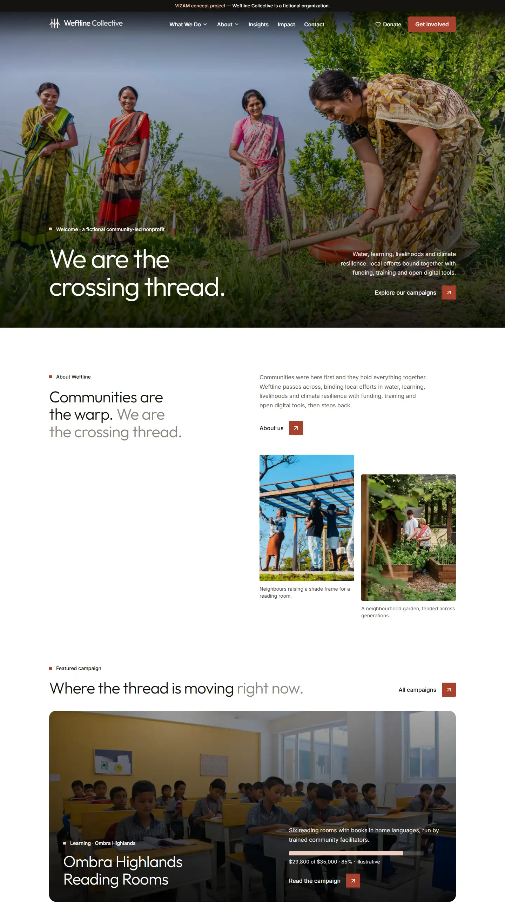
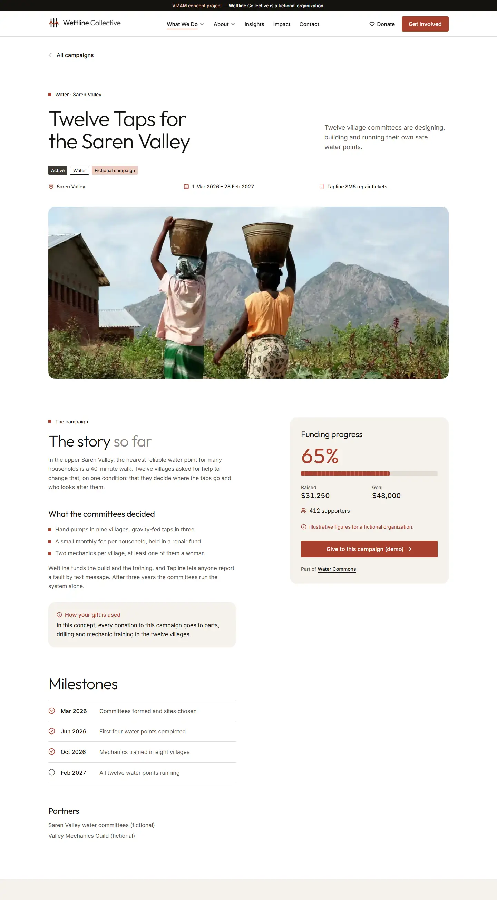
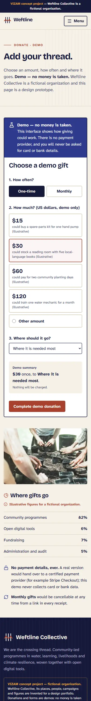
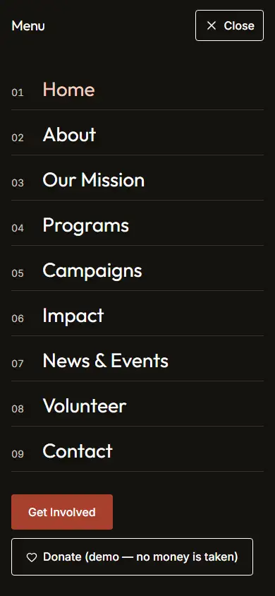

# Weftline Collective

**VIZAM concept project — fictional organization.** Weftline Collective is not a real NGO. It was invented by VIZAM as a
portfolio concept, not a client commission. There are no real donations: the donation flow is a demo and says
**"Demo — no money is taken"**. Impact figures, places (Saren Valley, Kestrel Coast, Ombra Highlands, Tamsin Delta,
Lowmere Plains), people and news items are illustrative figures for a fictional organization.

The idea: in weaving, the weft is the thread that crosses the fixed warp and binds it into cloth. Communities are the
warp; Weftline is the crossing thread, funding, tools and digital services for community-led programmes in water,
learning, livelihoods and climate resilience.

**Brand-name check (2026-11-05):** web searches for "Weftline", "Weftline Collective" and "Weftline" with
nonprofit/charity/foundation/NGO found no organization of that name. A search cannot rule out a tiny local group, so the
site is labelled fictional everywhere (footer included). Details in `docs/design-direction.md`.

## Screenshots

| Home (1440) | Campaign detail (1440) |
|---|---|
|  |  |

| Donate (390) | Menu open (390) |
|---|---|
|  |  |

More widths (240, 390, 768, 1440) are in `docs/screenshots/`.

## Stack

Next.js (App Router), TypeScript, Tailwind CSS 4, GSAP, Motion, Lucide React, React Hook Form + Zod, `next/image`,
Metadata API. Local structured content in `content/` (CMS-ready, no CMS). Tests: Vitest, Playwright, axe-core.
Vercel-compatible.

## Pages

Home `/`, Mission `/mission`, About `/about`, Programs `/programs`, Campaigns `/campaigns` and
`/campaigns/[slug]`, Impact `/impact`, News `/news` and `/news/[slug]`, Volunteer `/volunteer`, Donate `/donate`,
Contact `/contact`. Plus a 404 page, error pages, `sitemap.xml`, `robots.txt` and a generated Open Graph image.

## Setup and commands

Requires Node 20.9 or newer.

```bash
npm ci
npm run dev          # http://localhost:3104
npm run lint         # ESLint
npm run typecheck    # tsc --noEmit
npm test             # Vitest unit tests
npm run build        # production build
npm run test:e2e     # Playwright + axe; needs a fresh build (see below)
npm run screenshots  # layout checks + screenshots at 240/390/768/1440 px
npm run secret-scan  # planned, script not written yet (QA slice)
```

`npm run test:e2e` runs against `next start` on port 3104. Run `npm run build` first. If Playwright's web server times
out, start `npx next start -p 3104 -H 127.0.0.1` in another terminal first (an existing server is reused).
Port 3104 is used because 3000/3001 are often taken.

## Project structure

```
app/            routes (App Router), server actions in app/actions/forms.ts, sitemap, robots, OG image
components/     brand, campaigns, forms, layout, motion, news, sections, ui
content/        typed local content: site, programs, campaigns, news, impact, about, credits
lib/            Zod schemas, rate limiter, submission handling, filters, formatting, metadata helpers
public/         compressed WebP photography
tests/unit/     Vitest; tests/e2e/ Playwright + axe
scripts/        screenshots.mjs, compress-screenshots.mjs
docs/           design-direction, plan, report, handoff, screenshots
```

## Forms

Contact, volunteer and donate forms are server actions with the same behaviour:

- Server-side validation with Zod (client-side validation with React Hook Form is only a convenience).
- Honeypot field, silently treated as spam.
- Basic in-memory rate limiting by hashed client identifier.
- **Demo submission:** no email provider is configured, so nothing is delivered. The confirmation says so.
- Nothing is stored or logged. No personal data is persisted anywhere.
- The donation flow has no real-looking card fields and takes no money.

## Accessibility notes

- Semantic landmarks, skip link, visible focus states, keyboard-operable menu and filters.
- `prefers-reduced-motion` respected for GSAP and Motion animation.
- axe-core checks run in the Playwright suite on every page.
- Layout verified at 240, 390, 768 and 1440 px with no horizontal scroll from 300 px up and equal-size cards in grids.
- Below 250 px the layout locks at 500 px and the visitor pans (`#root` and fixed elements are 500 px wide,
  `html { overflow-x: auto }`; the mobile menu overlay pans so Close stays reachable).
- A full accessibility review is part of the QA slice and is not yet signed off.

## Photo credits

All photography is from Unsplash, used under the [Unsplash License](https://unsplash.com/license), committed as
compressed WebP. Source data: `content/credits.ts`.

| File | Photographer | Source |
|---|---|---|
| `hero-weaving-hands.webp` | [Anes mchayaa](https://unsplash.com/@anes02) | [Unsplash](https://unsplash.com/photos/two-people-are-working-on-a-piece-of-art-NWSIQh4Z0xg) |
| `loom-threads.webp` | [Chris Chow](https://unsplash.com/@chris_chow) | [Unsplash](https://unsplash.com/photos/person-holding-white-paper-towel-OQ1LDghuOEk) |
| `seedling-hands.webp` | [Hammilton Ojijo](https://unsplash.com/@ojijohammilton) | [Unsplash](https://unsplash.com/photos/two-pairs-of-hands-planting-a-small-green-seedling-OQC1dP2fL80) |
| `seedling-trays.webp` | [Alex Diaz](https://unsplash.com/@memory_terra) | [Unsplash](https://unsplash.com/photos/a-group-of-people-standing-around-a-table-filled-with-plants-2S1JhFhhSi4) |
| `field-planting.webp` | [Annie Spratt](https://unsplash.com/@anniespratt) | [Unsplash](https://unsplash.com/photos/people-working-on-field-cIP00akjCbw) |
| `water-pump.webp` | [Nishaan ahmed](https://unsplash.com/@nishaan_ahmed) | [Unsplash](https://unsplash.com/photos/a-man-standing-next-to-a-water-pump-oLfKHI0R4c0) |
| `classroom.webp` | [Haseeb Modi](https://unsplash.com/@haseebm) | [Unsplash](https://unsplash.com/photos/a-group-of-children-sitting-at-desks-in-a-classroom-OcDJhBm8Jnc) |
| `mangrove-saplings.webp` | [Thomas Lohmann](https://unsplash.com/@thomaslohmann) | [Unsplash](https://unsplash.com/photos/a-large-body-of-water-sitting-next-to-a-sandy-beach-N8Tn9ei20QA) |
| `volunteers-riverbank.webp` | [Vitaly Gariev](https://unsplash.com/@silverkblack) | [Unsplash](https://unsplash.com/photos/volunteers-collecting-trash-along-a-riverbank-tX-A7eBc45Q) |
| `volunteer-clipboard.webp` | [Vitaly Gariev](https://unsplash.com/@silverkblack) | [Unsplash](https://unsplash.com/photos/person-in-gloves-writing-on-clipboard-with-volunteers-in-background-HpW0eYZi0QI) |
| `highland-terraces.webp` | [Huy Nguyen](https://unsplash.com/@huynguyen_pch) | [Unsplash](https://unsplash.com/photos/terraced-rice-fields-in-the-mountains-with-clouds-zjBQjHDAcOU) |
| `harvest-path.webp` | [Salman Rameli](https://unsplash.com/@annoying_salman) | [Unsplash](https://unsplash.com/photos/man-carrying-baskets-of-vegetables-on-a-hillside-gAJI-V2yB6w) |
| `community-circle.webp` | [Dorota Trzaska](https://unsplash.com/@dtrzaska1) | [Unsplash](https://unsplash.com/photos/circle-of-people-sitting-on-chair-on-grass-fiedl-1tAtO-9HYNM) |
| `gathering-tree.webp` | [Anderson Schmig](https://unsplash.com/@schmig) | [Unsplash](https://unsplash.com/photos/a-group-of-people-sitting-around-a-tree-jtWOuLOVeC0) |
| `solar-valley.webp` | [Red Shuheart](https://unsplash.com/@mirrors_are_more_fun) | [Unsplash](https://unsplash.com/photos/solar-panels-in-a-rural-village-with-mountains-8A8La1VdsWU) |
| `market.webp` | [Wietse Jongsma](https://unsplash.com/@wietsej) | [Unsplash](https://unsplash.com/photos/bustling-outdoor-market-with-vendors-and-shoppers--OAYEZu641U) |
| `phone-map.webp` | [Bernd 📷 Dittrich](https://unsplash.com/@hdbernd) | [Unsplash](https://unsplash.com/photos/person-holding-smartphone-displaying-a-satellite-map-WOeiFjKnl-I) |
| `phone-mapping.webp` | [Linda Söndergaard](https://unsplash.com/@lindasondergaard) | [Unsplash](https://unsplash.com/photos/person-holding-samsung-galaxy-android-smartphone-oSvBeKi8vLA) |
| `fishing-boats.webp` | [Haseeb Modi](https://unsplash.com/@haseebm) | [Unsplash](https://unsplash.com/photos/boats-on-the-beach-3o1umDU_sIQ) |
| `delta-marsh.webp` | [Iain](https://unsplash.com/@photoken123) | [Unsplash](https://unsplash.com/photos/aerial-view-of-marshland-with-winding-waterways-3XqmItLi1xQ) |
| `community-build.webp` | [Divaris Shirichena](https://unsplash.com/@divaris) | [Unsplash](https://unsplash.com/photos/people-stand-under-a-pergola-on-a-sunny-day-U7Gr8M6Vf3s) |

## Deployment

Vercel-compatible (standard Next.js build, no environment variables required). **Not deployed**; no Vercel project is
linked. Production would also need: a real email or CRM provider for the forms, a shared store (for example Redis or
Vercel KV) for rate limiting, and a real payment provider if donations were ever real, which they are not here.

## Licence and status

Concept project by VIZAM. Weftline Collective is fictional; do not use the brand, figures or stories as real information.
Photographs belong to their photographers (see credits).
