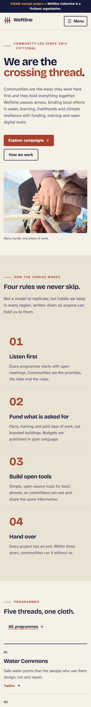

# Weftline Collective

**VIZAM concept project — fictional organization.** Weftline Collective is not a real NGO. It was invented by VIZAM as a
portfolio concept, not a client commission. There are no real donations: the donation flow is a demo and says
**"Demo — no money is taken"**. Impact figures, places (Saren Valley, Kestrel Coast, Ombra Highlands, Tamsin Delta,
Lowmere Plains), people and news items are illustrative figures for a fictional organization.

The idea: in weaving, the weft is the thread that crosses the fixed warp and binds it into cloth. Communities are the
warp; Weftline is the crossing thread, funding, tools and digital services for community-led programmes in water,
learning, livelihoods and climate resilience.

**Brand-name check (2026-11-05):** web searches for "Weftline", "Weftline Collective" and "Weftline" with
nonprofit/charity/foundation/NGO found no organization of that name. A search cannot rule out a tiny local group, so the
site is labelled fictional everywhere (footer included). Details in `docs/design-direction.md`.

## Screenshots

| Home (1440) | Campaign detail (1440) |
|---|---|
|  |  |

| Home (390) | Menu open (390) |
|---|---|
|  |  |

Home, Campaigns, a campaign detail, Donate, Volunteer and About at 240, 390, 768 and 1440 px, plus the open menu at 240,
390 and 768 px, are in `docs/screenshots/` (compressed WebP, long pages cropped at 2600 px).

## Design

A light, photograph-led layout: white page, near-black text, a warm-grey band for secondary sections and a single brown
accent. Outfit (light display) and Inter (text). A full-viewport photo hero with a transparent header that turns solid on
scroll, two-tone headings, square-bullet eyebrows, arrow links, a rounded feature card for the featured campaign,
full-bleed photo bands and tall image pairs with captions. The direction takes its characteristics from the editorial
feel of one reference nonprofit home page (no code, text, images or compositions copied); see `docs/design-direction.md`
and `docs/REFERENCE_ANALYSIS.md`.

## Stack

Next.js (App Router), TypeScript, Tailwind CSS 4, GSAP, Motion, Lucide React, React Hook Form + Zod, `next/image`,
Metadata API. Local structured content in `content/` (CMS-ready, no CMS). Tests: Vitest, Playwright, axe-core.
Vercel-compatible.

## Pages

Home `/`, Mission `/mission`, About `/about`, Programs `/programs`, Campaigns `/campaigns` and
`/campaigns/[slug]`, Impact `/impact`, News `/news` and `/news/[slug]`, Volunteer `/volunteer`, Donate `/donate`,
Contact `/contact`. Plus a 404 page, error pages, `sitemap.xml`, `robots.txt` and a generated Open Graph image.

## Setup and commands

Requires Node 20.9 or newer.

```bash
npm ci
npm run dev          # http://localhost:3104
npm run lint         # ESLint
npm run typecheck    # tsc --noEmit
npm test             # Vitest unit tests
npm run build        # production build
npm run test:e2e     # Playwright + axe; needs a fresh build (see below)
npm run screenshots  # layout checks + screenshots at 240/390/768/1440 px
npm run secret-scan  # scans tracked files and the full git history for keys and forbidden files
```

`npm run test:e2e` runs against `next start` on port 3104. Run `npm run build` first. If Playwright's web server times
out, start `npx next start -p 3104 -H 127.0.0.1` in another terminal first (an existing server is reused).
Port 3104 is used because 3000/3001 are often taken.

## Project structure

```
app/            routes (App Router), server actions in app/actions/forms.ts, sitemap, robots, OG image
components/     brand, campaigns, forms, layout, motion, news, sections, ui (FeatureCard, ImagePair, PhotoBand, primitives)
content/        typed local content: site, programs, campaigns, news, impact, about, credits
lib/            Zod schemas, rate limiter, submission handling, filters, formatting, metadata helpers
public/         compressed WebP photography
tests/unit/     Vitest; tests/e2e/ Playwright + axe
scripts/        screenshots.mjs, compress-screenshots.mjs, secret-scan.mjs
docs/           design-direction, REFERENCE_ANALYSIS, plan, report, handoff, screenshots (WebP)
```

## Forms

Contact, volunteer and donate forms are server actions with the same behaviour:

- Server-side validation with Zod (client-side validation with React Hook Form is only a convenience).
- Honeypot field, silently treated as spam.
- Basic in-memory rate limiting by hashed client identifier.
- **Demo submission:** no email provider is configured, so nothing is delivered. The confirmation says so.
- Nothing is stored or logged. No personal data is persisted anywhere.
- The donation flow has no real-looking card fields and takes no money.

## Accessibility notes

- Semantic landmarks, skip link, visible focus states, keyboard-operable menu and filters.
- `prefers-reduced-motion` respected for GSAP and Motion animation.
- axe-core checks run in the Playwright suite on every page.
- Layout verified at 240, 390, 768 and 1440 px with no horizontal scroll from 300 px up and equal-size cards in grids.
- Below 250 px the layout locks at 500 px and the visitor pans (`#root` and fixed elements are 500 px wide,
  `html { overflow-x: auto }`; the mobile menu overlay pans so Close stays reachable).
- axe-core passes on every page after the redesign. The full WCAG review and security sign-off are pending a re-run
  after the redesign; see [`docs/report.md`](docs/report.md).

## Photo credits

Photography is from Unsplash ([Unsplash License](https://unsplash.com/license)) and Pixabay
([Pixabay Content License](https://pixabay.com/service/license-summary/)), committed as compressed WebP. Source data: `content/credits.ts`.

| File | Photographer | Source |
|---|---|---|
| `classroom.webp` | [Haseeb Modi](https://unsplash.com/@haseebm) | [Unsplash](https://unsplash.com/photos/a-group-of-children-sitting-at-desks-in-a-classroom-OcDJhBm8Jnc) |
| `community-build.webp` | [Divaris Shirichena](https://unsplash.com/@divaris) | [Unsplash](https://unsplash.com/photos/people-stand-under-a-pergola-on-a-sunny-day-U7Gr8M6Vf3s) |
| `community-circle.webp` | [Dorota Trzaska](https://unsplash.com/@dtrzaska1) | [Unsplash](https://unsplash.com/photos/circle-of-people-sitting-on-chair-on-grass-fiedl-1tAtO-9HYNM) |
| `volunteers-riverbank.webp` | [Vitaly Gariev](https://unsplash.com/@silverkblack) | [Unsplash](https://unsplash.com/photos/volunteers-collecting-trash-along-a-riverbank-tX-A7eBc45Q) |
| `solar-valley.webp` | [Red Shuheart](https://unsplash.com/@mirrors_are_more_fun) | [Unsplash](https://unsplash.com/photos/solar-panels-in-a-rural-village-with-mountains-8A8La1VdsWU) |
| `highland-terraces.webp` | [Huy Nguyen](https://unsplash.com/@huynguyen_pch) | [Unsplash](https://unsplash.com/photos/terraced-rice-fields-in-the-mountains-with-clouds-zjBQjHDAcOU) |
| `market.webp` | [Wietse Jongsma](https://unsplash.com/@wietsej) | [Unsplash](https://unsplash.com/photos/bustling-outdoor-market-with-vendors-and-shoppers--OAYEZu641U) |
| `hero-farmers.webp` | [EqualStock](https://unsplash.com/@equalstock) | [Unsplash](https://unsplash.com/photos/a-group-of-women-standing-next-to-each-other-in-a-field-71L0v2kw424) |
| `greens-picking.webp` | [EqualStock](https://unsplash.com/@equalstock) | [Unsplash](https://unsplash.com/photos/a-group-of-women-working-in-a-field-0vu32v6BmSg) |
| `field-harvest.webp` | [EqualStock](https://unsplash.com/@equalstock) | [Unsplash](https://unsplash.com/photos/a-group-of-women-working-in-a-field-7KhazgCqCNA) |
| `seedling-planting.webp` | [E. Diop](https://unsplash.com/@ediop) | [Unsplash](https://unsplash.com/photos/a-person-holding-a-plant-XG6Fac3rc2Q) |
| `riverbank-planting.webp` | [The Tampa Bay Estuary Program](https://unsplash.com/@tbep) | [Unsplash](https://unsplash.com/photos/a-group-of-people-standing-next-to-a-river-CxL29J-aM5E) |
| `cold-store.webp` | [Paul Einerhand](https://unsplash.com/@pauleinerhand) | [Unsplash](https://unsplash.com/photos/man-in-white-shirt-and-black-pants-standing-beside-yellow-plastic-crates-YkYA4_430Qk) |
| `garden-tending.webp` | [Jelly Marketing](https://unsplash.com/@jellymarketing) | [Unsplash](https://unsplash.com/photos/teenager-and-woman-gardening-in-backyard-Z98GPfhsx3U) |
| `flood-maps.webp` | [Maël BALLAND](https://unsplash.com/@mael_balland) | [Unsplash](https://unsplash.com/photos/people-sitting-on-green-grass-field-during-daytime-7rImz-goqfQ) |
| `seed-grain.webp` | [Ali Mkumbwa](https://unsplash.com/@mkumbwajr) | [Unsplash](https://unsplash.com/photos/a-woman-holding-a-handful-of-grain-in-her-hands-s8Kzx7C6yqo) |
| `water-carriers.webp` | [Craig Manners](https://unsplash.com/@craigmanners_com) | [Unsplash](https://unsplash.com/photos/a-couple-of-men-carrying-buckets-on-their-heads-rXaFXr-bZHQ) |
| `volunteer-lead.webp` | [Vitaly Gariev](https://unsplash.com/@silverkblack) | [Unsplash](https://unsplash.com/photos/woman-with-clipboard-leads-park-cleanup-with-volunteers-fTn3_R00Q04) |
| `team-review.webp` | [Andreea Avramescu](https://unsplash.com/@minakko) | [Unsplash](https://unsplash.com/photos/people-reviewing-documents-in-workspace-wR56AUlEsE4) |
| `bean-sorting.webp` | [Max Panamá](https://unsplash.com/@imaxpanama) | [Unsplash](https://unsplash.com/photos/group-of-women-picking-beans-on-gray-table-Gt1A0jNzzbM) |
| `tree-planting.webp` | [Kumar_B](https://pixabay.com/users/Kumar_B-54666274/) | [Pixabay](https://pixabay.com/photos/earth-planet-space-nature-10182485/) |
| `code-club.webp` | [Poddar Group of Institutions](https://unsplash.com/@poddarcollegejpr) | [Unsplash](https://unsplash.com/photos/teacher-guiding-students-on-computer-in-classroom-ereEoYDIl20) |

## Deployment

Vercel-compatible (standard Next.js build, no environment variables required). **Not deployed**; no Vercel project is
linked. Production would also need: a real email or CRM provider for the forms, a shared store (for example Redis or
Vercel KV) for rate limiting, and a real payment provider if donations were ever real, which they are not here.

## Licence and status

Concept project by VIZAM. Weftline Collective is fictional; do not use the brand, figures or stories as real information.
Photographs belong to their photographers (see credits).
